# Microconcept Evidence Graph

总览按微概念分组；下方局部图用于审阅证据链。

## Overview

```mermaid
flowchart LR
  c_capacity_headroom["capacity_headroom"]:::microconcept
  f_current_ratio["current_ratio"]:::factor
  f_current_ratio --> c_capacity_headroom
  f_interest_coverage["interest_coverage"]:::factor
  f_interest_coverage --> c_capacity_headroom
  f_net_debt_to_ebitda["net_debt_to_ebitda"]:::factor
  f_net_debt_to_ebitda --> c_capacity_headroom
  f_ttm_operating_cash_flow["ttm_operating_cash_flow"]:::factor
  f_ttm_operating_cash_flow --> c_capacity_headroom
  q_liquidity_outlook["liquidity_outlook"]:::claim
  q_liquidity_outlook --> c_capacity_headroom
  q_refinancing_dependency["refinancing_dependency"]:::claim
  q_refinancing_dependency --> c_capacity_headroom
  q_covenant_risk["covenant_risk"]:::claim
  q_covenant_risk --> c_capacity_headroom
  m_mm_p1_buffer_capacity["缓冲与容量"]:::model
  c_capacity_headroom -->|supports| m_mm_p1_buffer_capacity
  m_mm_p1_safety_margin["安全边际"]:::model
  c_capacity_headroom -->|supports| m_mm_p1_safety_margin
  m_mm_p1_reliability_lifetime["可靠度与寿命分布"]:::model
  c_capacity_headroom -->|modulates| m_mm_p1_reliability_lifetime
  c_constraint_pressure["constraint_pressure"]:::microconcept
  f_ttm_revenue_growth["ttm_revenue_growth"]:::factor
  f_ttm_revenue_growth --> c_constraint_pressure
  f_gross_margin_change["gross_margin_change"]:::factor
  f_gross_margin_change --> c_constraint_pressure
  f_current_ratio["current_ratio"]:::factor
  f_current_ratio --> c_constraint_pressure
  f_receivables_growth_minus_revenue_growth["receivables_growth_minus_revenue_growth"]:::factor
  f_receivables_growth_minus_revenue_growth --> c_constraint_pressure
  f_inventory_growth_minus_revenue_growth["inventory_growth_minus_revenue_growth"]:::factor
  f_inventory_growth_minus_revenue_growth --> c_constraint_pressure
  q_revenue_demand_change["revenue_demand_change"]:::claim
  q_revenue_demand_change --> c_constraint_pressure
  q_margin_pressure["margin_pressure"]:::claim
  q_margin_pressure --> c_constraint_pressure
  q_working_capital_change["working_capital_change"]:::claim
  q_working_capital_change --> c_constraint_pressure
  q_operational_risk["operational_risk"]:::claim
  q_operational_risk --> c_constraint_pressure
  m_mm_p1_bottleneck["瓶颈"]:::model
  c_constraint_pressure -->|supports| m_mm_p1_bottleneck
  m_mm_p1_rate_control["速率控制"]:::model
  c_constraint_pressure -->|supports| m_mm_p1_rate_control
  m_mm_p1_optimization_constraints["优化与约束"]:::model
  c_constraint_pressure -->|supports| m_mm_p1_optimization_constraints
  c_conversion_gap["conversion_gap"]:::microconcept
  f_ttm_revenue_growth["ttm_revenue_growth"]:::factor
  f_ttm_revenue_growth --> c_conversion_gap
  f_ttm_operating_margin["ttm_operating_margin"]:::factor
  f_ttm_operating_margin --> c_conversion_gap
  f_ttm_operating_cash_flow["ttm_operating_cash_flow"]:::factor
  f_ttm_operating_cash_flow --> c_conversion_gap
  f_ttm_free_cash_flow["ttm_free_cash_flow"]:::factor
  f_ttm_free_cash_flow --> c_conversion_gap
  f_receivables_growth_minus_revenue_growth["receivables_growth_minus_revenue_growth"]:::factor
  f_receivables_growth_minus_revenue_growth --> c_conversion_gap
  f_inventory_growth_minus_revenue_growth["inventory_growth_minus_revenue_growth"]:::factor
  f_inventory_growth_minus_revenue_growth --> c_conversion_gap
  q_working_capital_change["working_capital_change"]:::claim
  q_working_capital_change --> c_conversion_gap
  q_margin_pressure["margin_pressure"]:::claim
  q_margin_pressure --> c_conversion_gap
  q_capital_allocation_change["capital_allocation_change"]:::claim
  q_capital_allocation_change --> c_conversion_gap
  m_mm_p1_bottleneck["瓶颈"]:::model
  c_conversion_gap -->|supports| m_mm_p1_bottleneck
  m_mm_p1_feedback_loop["反馈回路"]:::model
  c_conversion_gap -->|modulates| m_mm_p1_feedback_loop
  m_mm_p1_mass_stoichiometry["物质守恒与限制试剂"]:::model
  c_conversion_gap -->|supports| m_mm_p1_mass_stoichiometry
  c_countervailing_pressure["countervailing_pressure"]:::microconcept
  f_ttm_revenue_growth["ttm_revenue_growth"]:::factor
  f_ttm_revenue_growth --> c_countervailing_pressure
  f_gross_margin_change["gross_margin_change"]:::factor
  f_gross_margin_change --> c_countervailing_pressure
  f_ttm_capex["ttm_capex"]:::factor
  f_ttm_capex --> c_countervailing_pressure
  f_net_debt_to_ebitda["net_debt_to_ebitda"]:::factor
  f_net_debt_to_ebitda --> c_countervailing_pressure
  f_interest_coverage["interest_coverage"]:::factor
  f_interest_coverage --> c_countervailing_pressure
  q_revenue_demand_change["revenue_demand_change"]:::claim
  q_revenue_demand_change --> c_countervailing_pressure
  q_margin_pressure["margin_pressure"]:::claim
  q_margin_pressure --> c_countervailing_pressure
  q_capital_allocation_change["capital_allocation_change"]:::claim
  q_capital_allocation_change --> c_countervailing_pressure
  q_covenant_risk["covenant_risk"]:::claim
  q_covenant_risk --> c_countervailing_pressure
  m_mm_p1_force_balance["力与平衡"]:::model
  c_countervailing_pressure -->|requires| m_mm_p1_force_balance
  m_mm_p1_equilibrium_response["平衡扰动响应"]:::model
  c_countervailing_pressure -->|supports| m_mm_p1_equilibrium_response
  m_mm_p1_feedback_loop["反馈回路"]:::model
  c_countervailing_pressure -->|modulates| m_mm_p1_feedback_loop
  c_evidence_quality["evidence_quality"]:::microconcept
  f_earnings_surprise_zscore["earnings_surprise_zscore"]:::factor
  f_earnings_surprise_zscore --> c_evidence_quality
  f_earnings_volatility["earnings_volatility"]:::factor
  f_earnings_volatility --> c_evidence_quality
  q_guidance_revision["guidance_revision"]:::claim
  q_guidance_revision --> c_evidence_quality
  q_liquidity_outlook["liquidity_outlook"]:::claim
  q_liquidity_outlook --> c_evidence_quality
  q_operational_risk["operational_risk"]:::claim
  q_operational_risk --> c_evidence_quality
  q_demand_outlook["demand_outlook"]:::claim
  q_demand_outlook --> c_evidence_quality
  m_mm_p1_numerical_error["数值误差传播"]:::model
  c_evidence_quality -->|supports| m_mm_p1_numerical_error
  m_mm_p1_bayesian_update["贝叶斯更新"]:::model
  c_evidence_quality -->|modulates| m_mm_p1_bayesian_update
  m_mm_p1_local_sensitivity["局部敏感度"]:::model
  c_evidence_quality -->|challenges| m_mm_p1_local_sensitivity
  c_feedback_polarity["feedback_polarity"]:::microconcept
  f_ttm_revenue_growth["ttm_revenue_growth"]:::factor
  f_ttm_revenue_growth --> c_feedback_polarity
  f_gross_margin_change["gross_margin_change"]:::factor
  f_gross_margin_change --> c_feedback_polarity
  f_ttm_free_cash_flow["ttm_free_cash_flow"]:::factor
  f_ttm_free_cash_flow --> c_feedback_polarity
  f_ttm_capex["ttm_capex"]:::factor
  f_ttm_capex --> c_feedback_polarity
  f_roic["roic"]:::factor
  f_roic --> c_feedback_polarity
  q_reinvestment_quality["reinvestment_quality"]:::claim
  q_reinvestment_quality --> c_feedback_polarity
  q_capital_allocation_change["capital_allocation_change"]:::claim
  q_capital_allocation_change --> c_feedback_polarity
  q_operational_risk["operational_risk"]:::claim
  q_operational_risk --> c_feedback_polarity
  q_demand_outlook["demand_outlook"]:::claim
  q_demand_outlook --> c_feedback_polarity
  m_mm_p1_feedback_loop["反馈回路"]:::model
  c_feedback_polarity -->|supports| m_mm_p1_feedback_loop
  m_mm_p1_equilibrium_response["平衡扰动响应"]:::model
  c_feedback_polarity -->|supports| m_mm_p1_equilibrium_response
  m_mm_p1_stability_transition["稳定性与相变"]:::model
  c_feedback_polarity -->|modulates| m_mm_p1_stability_transition
  c_outcome_asymmetry["outcome_asymmetry"]:::microconcept
  f_free_cash_flow_yield["free_cash_flow_yield"]:::factor
  f_free_cash_flow_yield --> c_outcome_asymmetry
  f_valuation_percentile["valuation_percentile"]:::factor
  f_valuation_percentile --> c_outcome_asymmetry
  f_earnings_volatility["earnings_volatility"]:::factor
  f_earnings_volatility --> c_outcome_asymmetry
  f_trailing_drawdown["trailing_drawdown"]:::factor
  f_trailing_drawdown --> c_outcome_asymmetry
  f_interest_coverage["interest_coverage"]:::factor
  f_interest_coverage --> c_outcome_asymmetry
  q_demand_outlook["demand_outlook"]:::claim
  q_demand_outlook --> c_outcome_asymmetry
  q_liquidity_outlook["liquidity_outlook"]:::claim
  q_liquidity_outlook --> c_outcome_asymmetry
  q_operational_risk["operational_risk"]:::claim
  q_operational_risk --> c_outcome_asymmetry
  q_guidance_revision["guidance_revision"]:::claim
  q_guidance_revision --> c_outcome_asymmetry
  m_mm_p1_expected_value["期望值"]:::model
  c_outcome_asymmetry -->|requires| m_mm_p1_expected_value
  m_mm_p1_opportunity_cost["机会成本"]:::model
  c_outcome_asymmetry -->|supports| m_mm_p1_opportunity_cost
  m_mm_p1_safety_margin["安全边际"]:::model
  c_outcome_asymmetry -->|modulates| m_mm_p1_safety_margin
  c_regime_proximity["regime_proximity"]:::microconcept
  f_current_ratio["current_ratio"]:::factor
  f_current_ratio --> c_regime_proximity
  f_interest_coverage["interest_coverage"]:::factor
  f_interest_coverage --> c_regime_proximity
  f_net_debt_to_ebitda["net_debt_to_ebitda"]:::factor
  f_net_debt_to_ebitda --> c_regime_proximity
  f_earnings_volatility["earnings_volatility"]:::factor
  f_earnings_volatility --> c_regime_proximity
  f_gross_margin_change["gross_margin_change"]:::factor
  f_gross_margin_change --> c_regime_proximity
  q_liquidity_outlook["liquidity_outlook"]:::claim
  q_liquidity_outlook --> c_regime_proximity
  q_covenant_risk["covenant_risk"]:::claim
  q_covenant_risk --> c_regime_proximity
  q_margin_pressure["margin_pressure"]:::claim
  q_margin_pressure --> c_regime_proximity
  q_operational_risk["operational_risk"]:::claim
  q_operational_risk --> c_regime_proximity
  m_mm_p1_stability_transition["稳定性与相变"]:::model
  c_regime_proximity -->|supports| m_mm_p1_stability_transition
  m_mm_p1_safety_margin["安全边际"]:::model
  c_regime_proximity -->|supports| m_mm_p1_safety_margin
  m_mm_p1_buffer_capacity["缓冲与容量"]:::model
  c_regime_proximity -->|requires| m_mm_p1_buffer_capacity
  c_relative_gradient["relative_gradient"]:::microconcept
  f_ttm_revenue_growth["ttm_revenue_growth"]:::factor
  f_ttm_revenue_growth --> c_relative_gradient
  f_gross_margin_change["gross_margin_change"]:::factor
  f_gross_margin_change --> c_relative_gradient
  f_earnings_surprise_zscore["earnings_surprise_zscore"]:::factor
  f_earnings_surprise_zscore --> c_relative_gradient
  f_valuation_percentile["valuation_percentile"]:::factor
  f_valuation_percentile --> c_relative_gradient
  f_trailing_drawdown["trailing_drawdown"]:::factor
  f_trailing_drawdown --> c_relative_gradient
  q_revenue_demand_change["revenue_demand_change"]:::claim
  q_revenue_demand_change --> c_relative_gradient
  q_margin_pressure["margin_pressure"]:::claim
  q_margin_pressure --> c_relative_gradient
  q_guidance_revision["guidance_revision"]:::claim
  q_guidance_revision --> c_relative_gradient
  q_demand_outlook["demand_outlook"]:::claim
  q_demand_outlook --> c_relative_gradient
  m_mm_p1_diffusion_gradient["扩散与梯度"]:::model
  c_relative_gradient -->|supports| m_mm_p1_diffusion_gradient
  m_mm_p1_opportunity_cost["机会成本"]:::model
  c_relative_gradient -->|supports| m_mm_p1_opportunity_cost
  m_mm_p1_local_sensitivity["局部敏感度"]:::model
  c_relative_gradient -->|modulates| m_mm_p1_local_sensitivity
  c_resource_balance["resource_balance"]:::microconcept
  f_ttm_operating_cash_flow["ttm_operating_cash_flow"]:::factor
  f_ttm_operating_cash_flow --> c_resource_balance
  f_ttm_capex["ttm_capex"]:::factor
  f_ttm_capex --> c_resource_balance
  f_ttm_free_cash_flow["ttm_free_cash_flow"]:::factor
  f_ttm_free_cash_flow --> c_resource_balance
  f_ttm_revenue_growth["ttm_revenue_growth"]:::factor
  f_ttm_revenue_growth --> c_resource_balance
  q_working_capital_change["working_capital_change"]:::claim
  q_working_capital_change --> c_resource_balance
  q_capital_allocation_change["capital_allocation_change"]:::claim
  q_capital_allocation_change --> c_resource_balance
  q_operational_risk["operational_risk"]:::claim
  q_operational_risk --> c_resource_balance
  m_mm_p1_mass_stoichiometry["物质守恒与限制试剂"]:::model
  c_resource_balance -->|supports| m_mm_p1_mass_stoichiometry
  m_mm_p1_energy_conservation["能量守恒"]:::model
  c_resource_balance -->|supports| m_mm_p1_energy_conservation
  m_mm_p1_function_mapping["函数与映射"]:::model
  c_resource_balance -->|modulates| m_mm_p1_function_mapping
  c_temporal_persistence["temporal_persistence"]:::microconcept
  f_free_cash_flow_positive_years["free_cash_flow_positive_years"]:::factor
  f_free_cash_flow_positive_years --> c_temporal_persistence
  f_roic["roic"]:::factor
  f_roic --> c_temporal_persistence
  f_ttm_revenue_growth["ttm_revenue_growth"]:::factor
  f_ttm_revenue_growth --> c_temporal_persistence
  f_earnings_volatility["earnings_volatility"]:::factor
  f_earnings_volatility --> c_temporal_persistence
  f_ttm_operating_margin["ttm_operating_margin"]:::factor
  f_ttm_operating_margin --> c_temporal_persistence
  q_revenue_demand_change["revenue_demand_change"]:::claim
  q_revenue_demand_change --> c_temporal_persistence
  q_margin_pressure["margin_pressure"]:::claim
  q_margin_pressure --> c_temporal_persistence
  q_reinvestment_quality["reinvestment_quality"]:::claim
  q_reinvestment_quality --> c_temporal_persistence
  q_operational_risk["operational_risk"]:::claim
  q_operational_risk --> c_temporal_persistence
  m_mm_p1_compounding["复利"]:::model
  c_temporal_persistence -->|supports| m_mm_p1_compounding
  m_mm_p1_reliability_lifetime["可靠度与寿命分布"]:::model
  c_temporal_persistence -->|supports| m_mm_p1_reliability_lifetime
  m_mm_p1_stability_transition["稳定性与相变"]:::model
  c_temporal_persistence -->|modulates| m_mm_p1_stability_transition
  classDef model fill:#dbeafe,stroke:#2563eb,color:#172554;
  classDef microconcept fill:#dcfce7,stroke:#16a34a,color:#052e16;
  classDef factor fill:#ffedd5,stroke:#ea580c,color:#431407;
  classDef claim fill:#f3e8ff,stroke:#9333ea,color:#3b0764;
```

## capacity_headroom

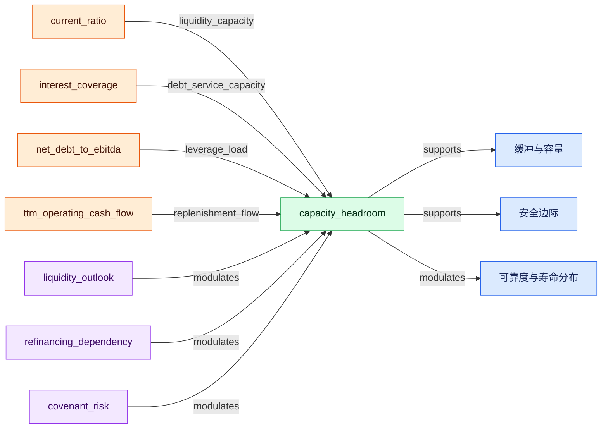

## constraint_pressure

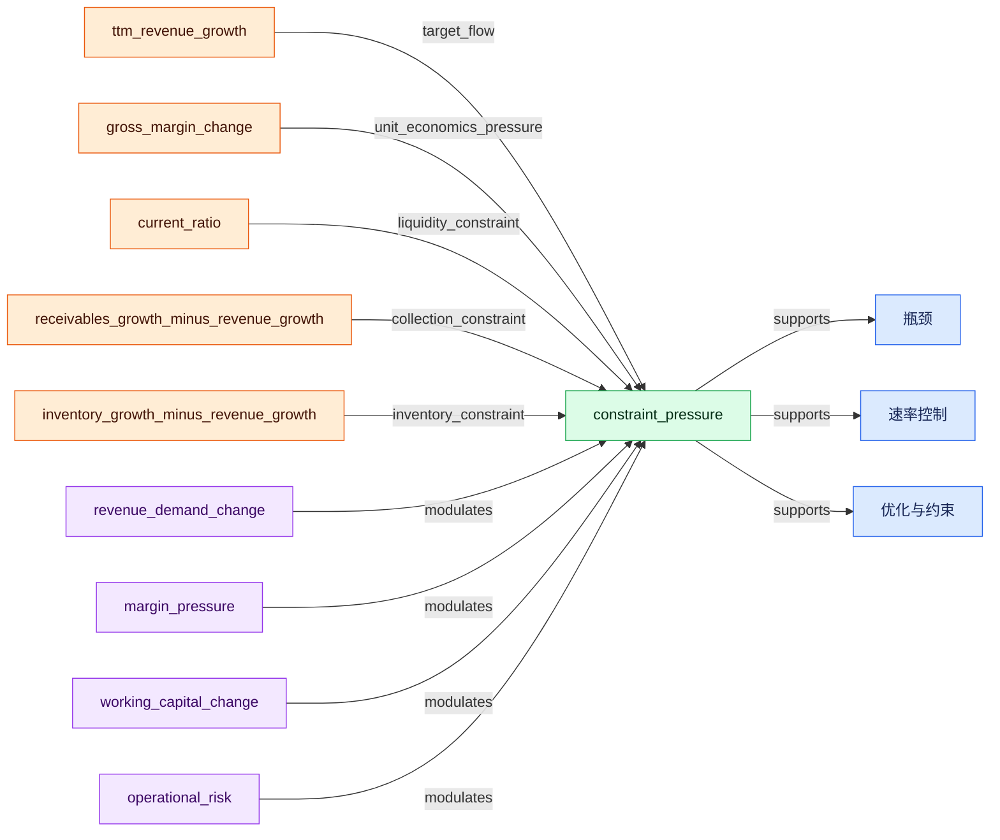

## conversion_gap

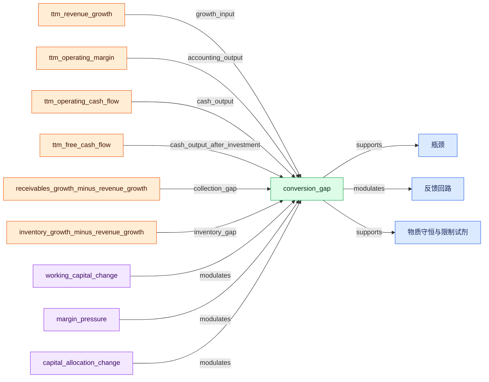

## countervailing_pressure

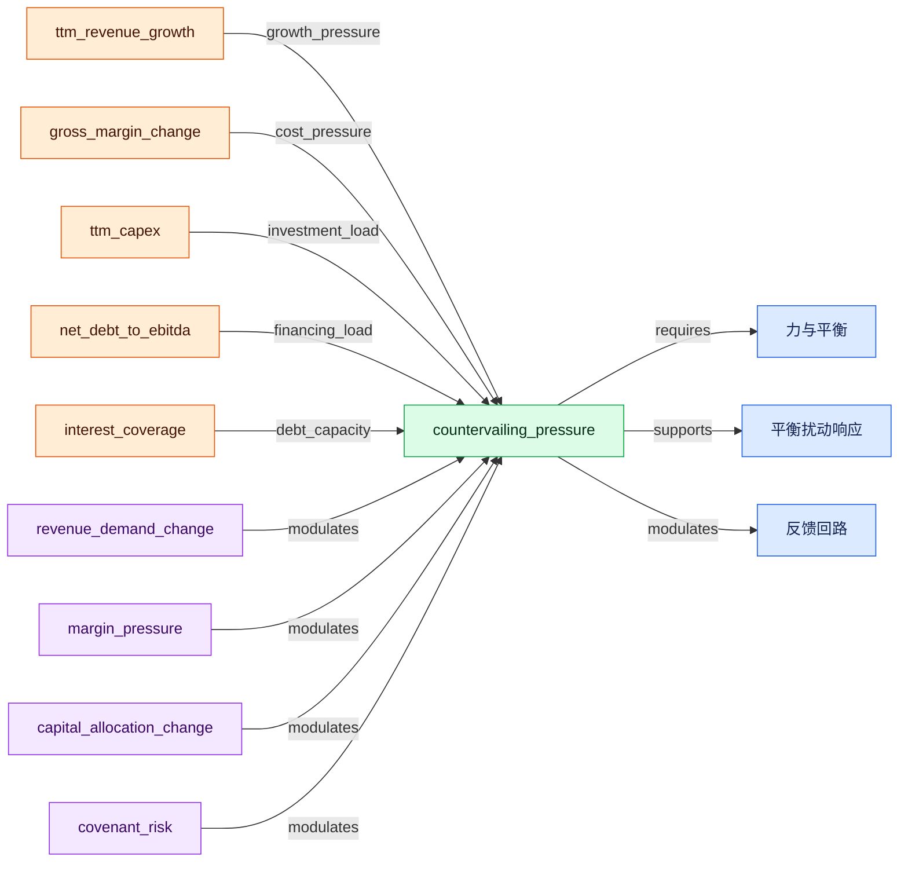

## evidence_quality

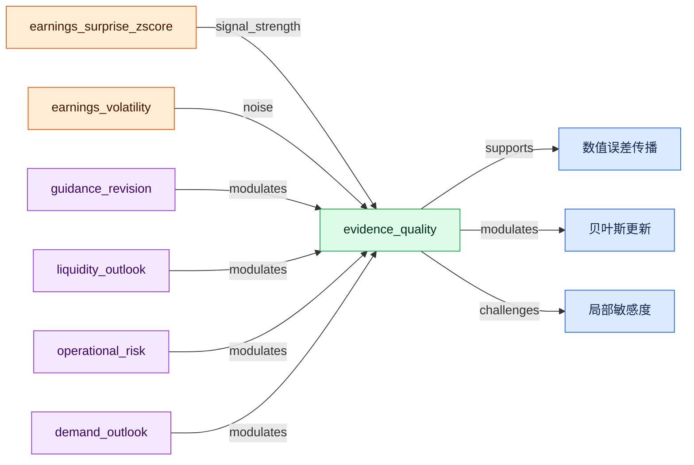

## feedback_polarity

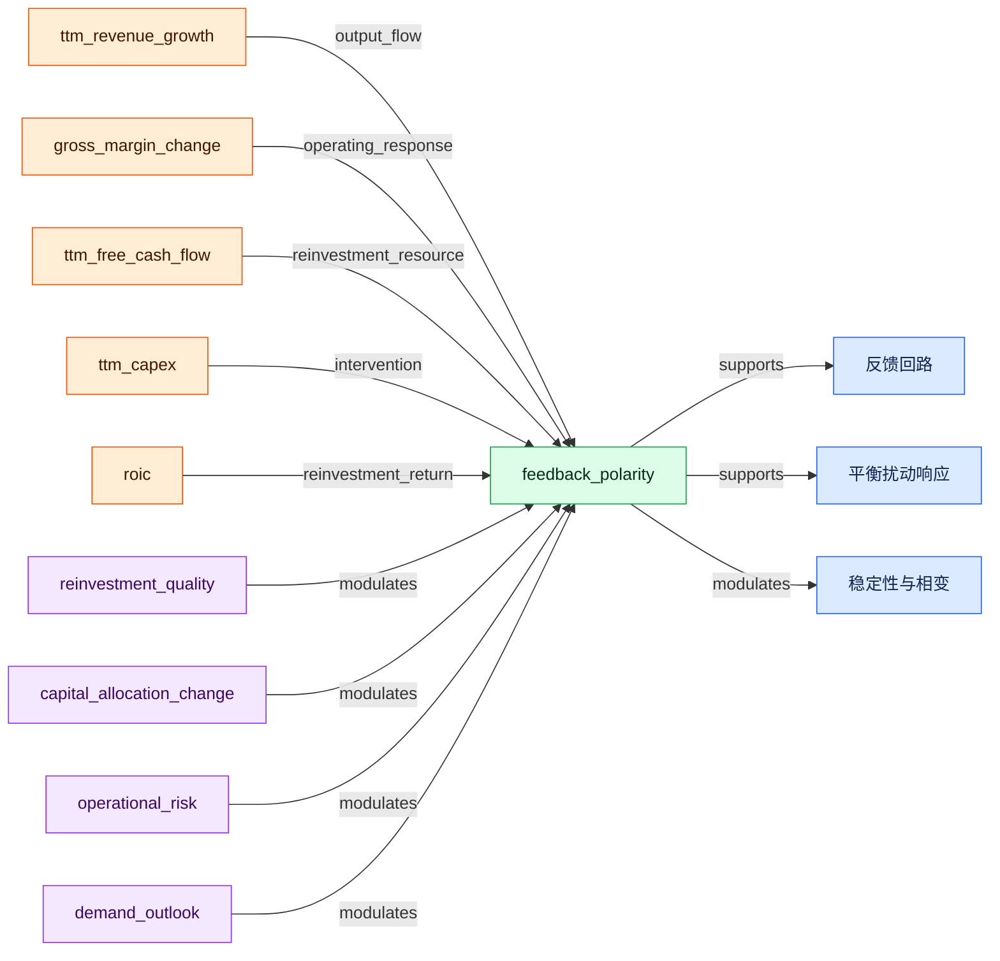

## outcome_asymmetry

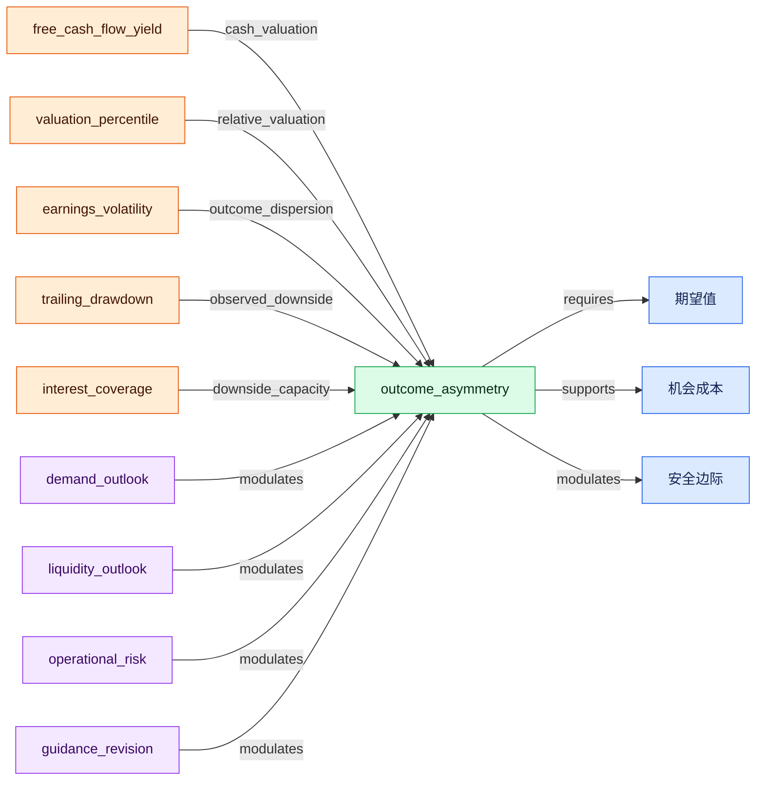

## regime_proximity

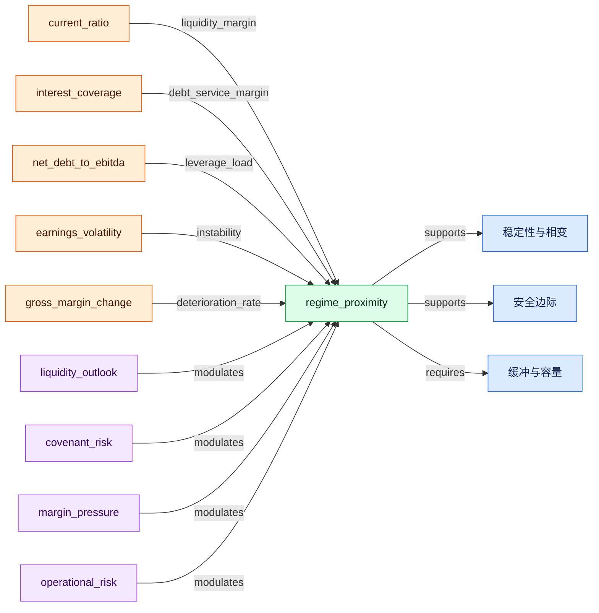

## relative_gradient

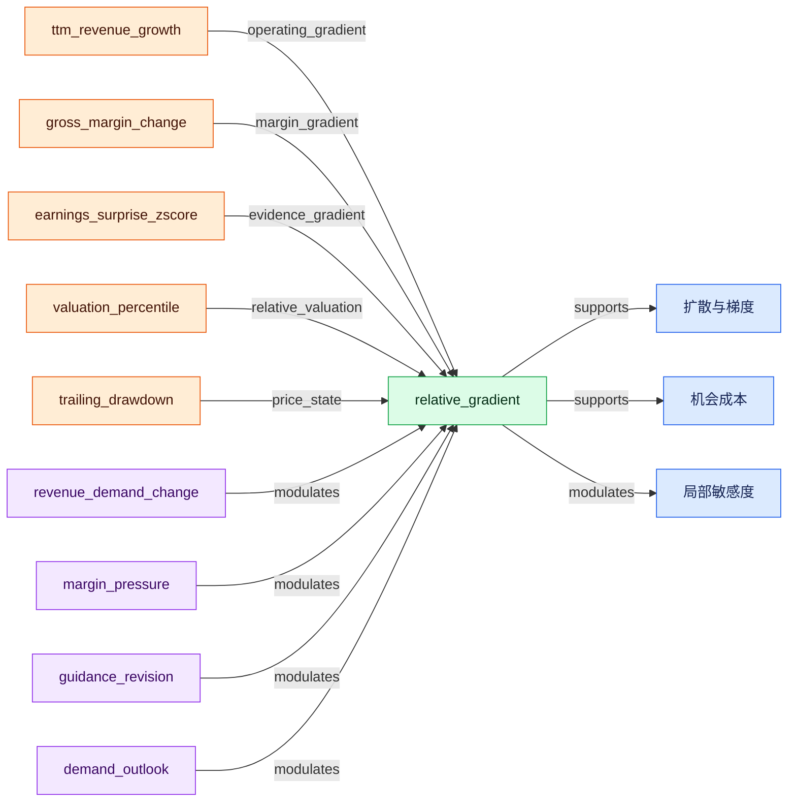

## resource_balance

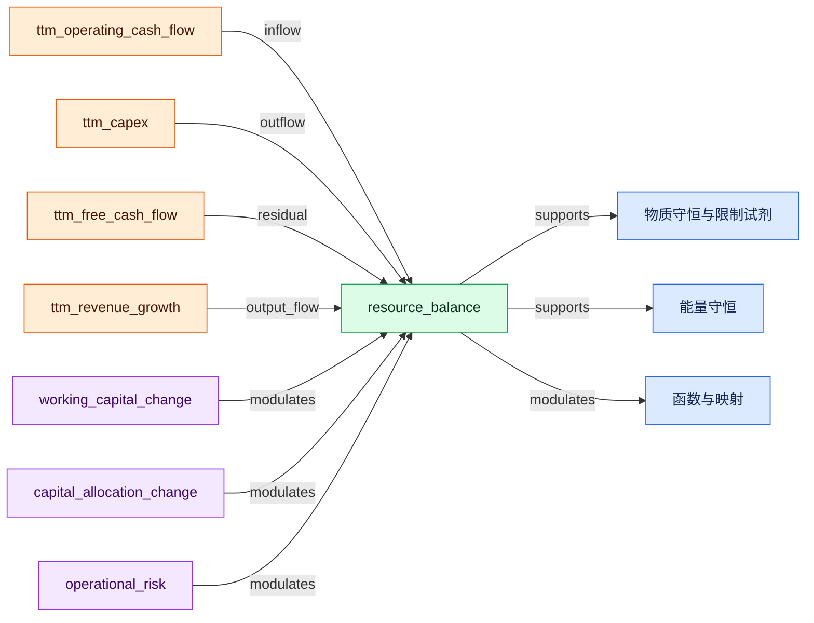

## temporal_persistence

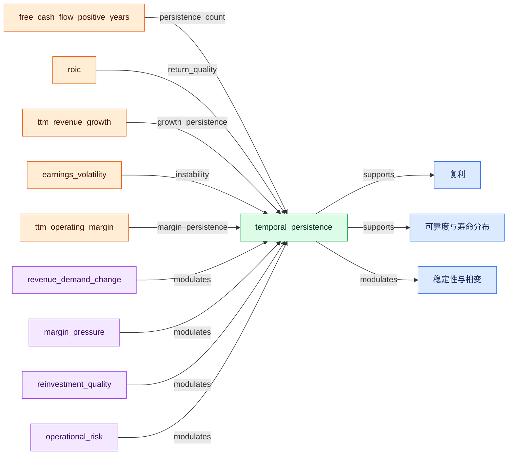
