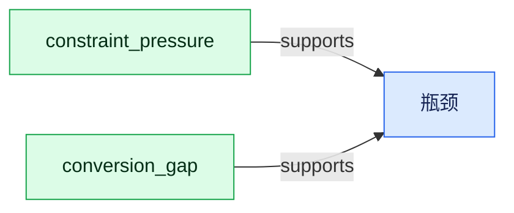
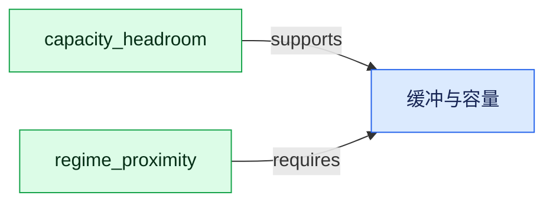
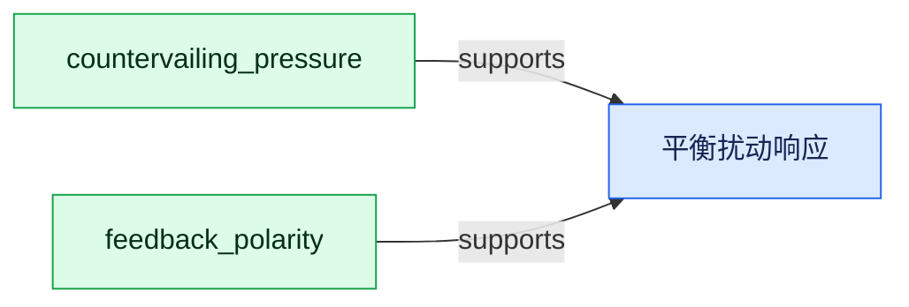
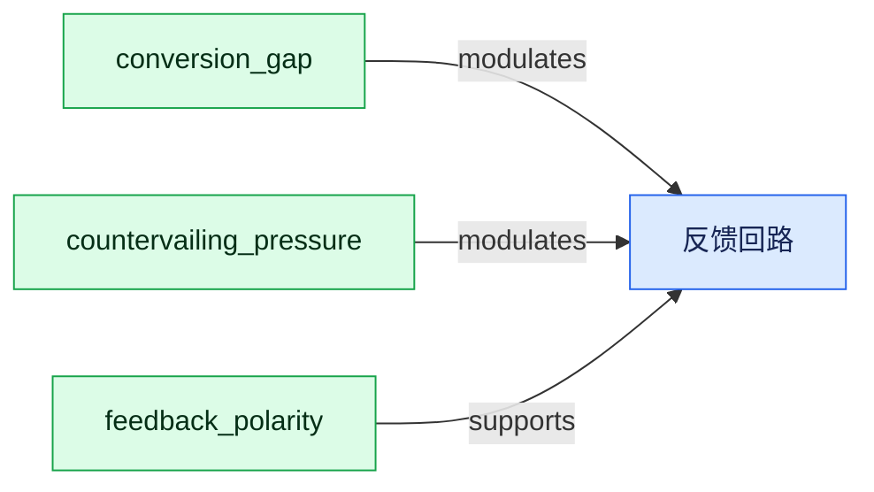
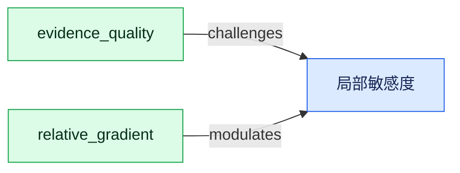
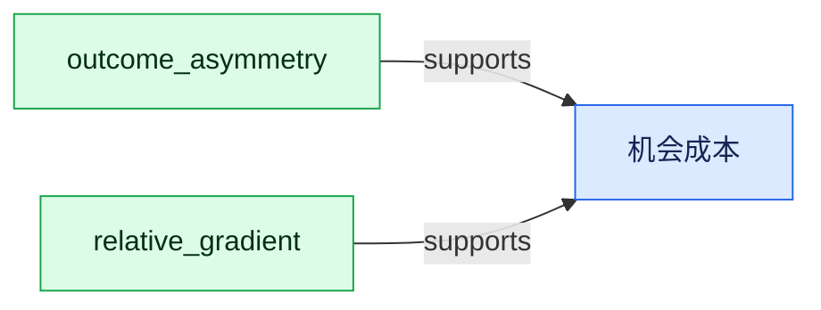
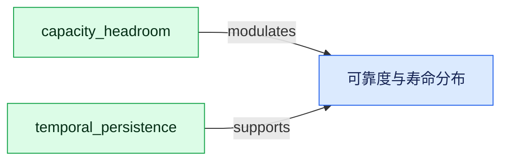
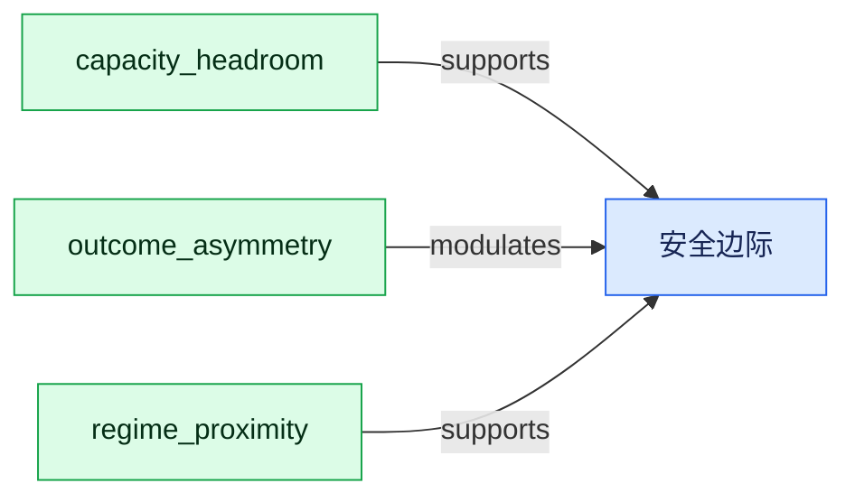

# Model Microconcept Graph

## Overview

```mermaid
flowchart LR
  c_capacity_headroom["capacity_headroom"]:::microconcept
  m_mm_p1_buffer_capacity["缓冲与容量"]:::model
  c_capacity_headroom -->|supports| m_mm_p1_buffer_capacity
  m_mm_p1_safety_margin["安全边际"]:::model
  c_capacity_headroom -->|supports| m_mm_p1_safety_margin
  m_mm_p1_reliability_lifetime["可靠度与寿命分布"]:::model
  c_capacity_headroom -->|modulates| m_mm_p1_reliability_lifetime
  c_constraint_pressure["constraint_pressure"]:::microconcept
  m_mm_p1_bottleneck["瓶颈"]:::model
  c_constraint_pressure -->|supports| m_mm_p1_bottleneck
  m_mm_p1_rate_control["速率控制"]:::model
  c_constraint_pressure -->|supports| m_mm_p1_rate_control
  m_mm_p1_optimization_constraints["优化与约束"]:::model
  c_constraint_pressure -->|supports| m_mm_p1_optimization_constraints
  c_conversion_gap["conversion_gap"]:::microconcept
  m_mm_p1_bottleneck["瓶颈"]:::model
  c_conversion_gap -->|supports| m_mm_p1_bottleneck
  m_mm_p1_feedback_loop["反馈回路"]:::model
  c_conversion_gap -->|modulates| m_mm_p1_feedback_loop
  m_mm_p1_mass_stoichiometry["物质守恒与限制试剂"]:::model
  c_conversion_gap -->|supports| m_mm_p1_mass_stoichiometry
  c_countervailing_pressure["countervailing_pressure"]:::microconcept
  m_mm_p1_force_balance["力与平衡"]:::model
  c_countervailing_pressure -->|requires| m_mm_p1_force_balance
  m_mm_p1_equilibrium_response["平衡扰动响应"]:::model
  c_countervailing_pressure -->|supports| m_mm_p1_equilibrium_response
  m_mm_p1_feedback_loop["反馈回路"]:::model
  c_countervailing_pressure -->|modulates| m_mm_p1_feedback_loop
  c_evidence_quality["evidence_quality"]:::microconcept
  m_mm_p1_numerical_error["数值误差传播"]:::model
  c_evidence_quality -->|supports| m_mm_p1_numerical_error
  m_mm_p1_bayesian_update["贝叶斯更新"]:::model
  c_evidence_quality -->|modulates| m_mm_p1_bayesian_update
  m_mm_p1_local_sensitivity["局部敏感度"]:::model
  c_evidence_quality -->|challenges| m_mm_p1_local_sensitivity
  c_feedback_polarity["feedback_polarity"]:::microconcept
  m_mm_p1_feedback_loop["反馈回路"]:::model
  c_feedback_polarity -->|supports| m_mm_p1_feedback_loop
  m_mm_p1_equilibrium_response["平衡扰动响应"]:::model
  c_feedback_polarity -->|supports| m_mm_p1_equilibrium_response
  m_mm_p1_stability_transition["稳定性与相变"]:::model
  c_feedback_polarity -->|modulates| m_mm_p1_stability_transition
  c_outcome_asymmetry["outcome_asymmetry"]:::microconcept
  m_mm_p1_expected_value["期望值"]:::model
  c_outcome_asymmetry -->|requires| m_mm_p1_expected_value
  m_mm_p1_opportunity_cost["机会成本"]:::model
  c_outcome_asymmetry -->|supports| m_mm_p1_opportunity_cost
  m_mm_p1_safety_margin["安全边际"]:::model
  c_outcome_asymmetry -->|modulates| m_mm_p1_safety_margin
  c_regime_proximity["regime_proximity"]:::microconcept
  m_mm_p1_stability_transition["稳定性与相变"]:::model
  c_regime_proximity -->|supports| m_mm_p1_stability_transition
  m_mm_p1_safety_margin["安全边际"]:::model
  c_regime_proximity -->|supports| m_mm_p1_safety_margin
  m_mm_p1_buffer_capacity["缓冲与容量"]:::model
  c_regime_proximity -->|requires| m_mm_p1_buffer_capacity
  c_relative_gradient["relative_gradient"]:::microconcept
  m_mm_p1_diffusion_gradient["扩散与梯度"]:::model
  c_relative_gradient -->|supports| m_mm_p1_diffusion_gradient
  m_mm_p1_opportunity_cost["机会成本"]:::model
  c_relative_gradient -->|supports| m_mm_p1_opportunity_cost
  m_mm_p1_local_sensitivity["局部敏感度"]:::model
  c_relative_gradient -->|modulates| m_mm_p1_local_sensitivity
  c_resource_balance["resource_balance"]:::microconcept
  m_mm_p1_mass_stoichiometry["物质守恒与限制试剂"]:::model
  c_resource_balance -->|supports| m_mm_p1_mass_stoichiometry
  m_mm_p1_energy_conservation["能量守恒"]:::model
  c_resource_balance -->|supports| m_mm_p1_energy_conservation
  m_mm_p1_function_mapping["函数与映射"]:::model
  c_resource_balance -->|modulates| m_mm_p1_function_mapping
  c_temporal_persistence["temporal_persistence"]:::microconcept
  m_mm_p1_compounding["复利"]:::model
  c_temporal_persistence -->|supports| m_mm_p1_compounding
  m_mm_p1_reliability_lifetime["可靠度与寿命分布"]:::model
  c_temporal_persistence -->|supports| m_mm_p1_reliability_lifetime
  m_mm_p1_stability_transition["稳定性与相变"]:::model
  c_temporal_persistence -->|modulates| m_mm_p1_stability_transition
  classDef model fill:#dbeafe,stroke:#2563eb,color:#172554;
  classDef microconcept fill:#dcfce7,stroke:#16a34a,color:#052e16;
  classDef factor fill:#ffedd5,stroke:#ea580c,color:#431407;
  classDef claim fill:#f3e8ff,stroke:#9333ea,color:#3b0764;
```



## 贝叶斯更新 (`mm-p1-bayesian-update`)


## 瓶颈 (`mm-p1-bottleneck`)



## 缓冲与容量 (`mm-p1-buffer-capacity`)



## 复利 (`mm-p1-compounding`)


## 扩散与梯度 (`mm-p1-diffusion-gradient`)


## 能量守恒 (`mm-p1-energy-conservation`)


## 平衡扰动响应 (`mm-p1-equilibrium-response`)



## 期望值 (`mm-p1-expected-value`)


## 反馈回路 (`mm-p1-feedback-loop`)



## 力与平衡 (`mm-p1-force-balance`)


## 函数与映射 (`mm-p1-function-mapping`)


## 局部敏感度 (`mm-p1-local-sensitivity`)



## 物质守恒与限制试剂 (`mm-p1-mass-stoichiometry`)


## 数值误差传播 (`mm-p1-numerical-error`)


## 机会成本 (`mm-p1-opportunity-cost`)



## 优化与约束 (`mm-p1-optimization-constraints`)


## 速率控制 (`mm-p1-rate-control`)


## 可靠度与寿命分布 (`mm-p1-reliability-lifetime`)



## 安全边际 (`mm-p1-safety-margin`)



## 稳定性与相变 (`mm-p1-stability-transition`)

```mermaid
flowchart LR
  m_mm_p1_stability_transition["稳定性与相变"]:::model
  c_feedback_polarity["feedback_polarity"]:::microconcept
  c_feedback_polarity -->|modulates| m_mm_p1_stability_transition
  c_regime_proximity["regime_proximity"]:::microconcept
  c_regime_proximity -->|supports| m_mm_p1_stability_transition
  c_temporal_persistence["temporal_persistence"]:::microconcept
  c_temporal_persistence -->|modulates| m_mm_p1_stability_transition
  classDef model fill:#dbeafe,stroke:#2563eb,color:#172554;
  classDef microconcept fill:#dcfce7,stroke:#16a34a,color:#052e16;
  classDef factor fill:#ffedd5,stroke:#ea580c,color:#431407;
  classDef claim fill:#f3e8ff,stroke:#9333ea,color:#3b0764;
```
